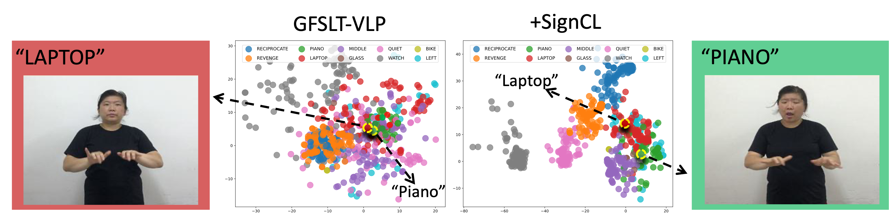
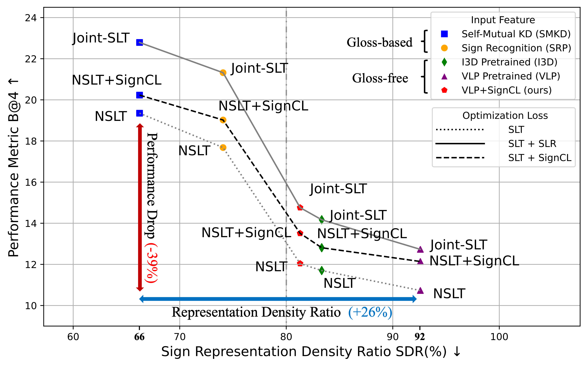
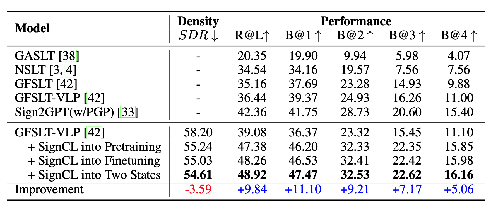

# [SignCL: Improving Gloss-free Sign Language Translation by Reducing Representation Density (NeurIPS'24)](https://arxiv.org/abs/2405.14312)

## Overview
`SignCL` is a PyTorch module designed to enhance sign language translation models by encouraging the learning of more discriminative feature representations. It brings the visual representations of sign gestures with identical semantics closer together while pushing those with different semantics farther apart through contrastive learning. This module can be integrated into both the pretraining and finetuning stages of a sign language translation model. Experiments demonstrate that `SignCL` can significantly reduce representation density and improve performance across various translation frameworks.

<figure>
  
  <!-- <figcaption>
    The GFSLT-VLP model incorrectly translates “钢琴” (piano) as “电脑” (laptop) due to their representations being too close to others. `SignCL` effectively separates the representations of “电脑” (laptop) and “钢琴” (piano) in the feature space, enabling the accurate translation of “钢琴” (piano).
  </figcaption> -->
</figure>

## Representation Density and Performance Drop
We consistently observed a negative
relationship between representation density and performance. Specifically, an increase in the representation density <span style="color:blue;">(+26%)</span> can result in a
performance drop <span style="color:red;">(-39%)</span> in BLEU score.

<details>
  <summary>Click to see figure!</summary>
<figure>
  
</figure>
</details>


## Installation

To use `SignCL`, ensure you have the following dependencies installed:

- Python 3.x
- PyTorch
- torchvision (optional, for dataset handling)
- Other standard libraries (e.g., random, numpy)
- conda env: conda create -n SignCL-opt-38 python=3.8 -y
## Checkpoints
Checkpoints can be found in [here](https://drive.google.com/drive/folders/1JdxKylEmoaRpyqCYtb92cYgr2eDbiGJG?usp=sharing)

## Usage
Here's a step-by-step guide to integrating SignCL into your sign language translation model.
```bash
0. cl_criterion = SignCL()
1. frames_feature = model.encoder(src_input)
2. margin = min(20, max(10, int(num_frames // text_length * 2.3)))
3. cl_loss = cl_criterion(frames_feature, margin=margin)
4. total_loss = lambda_ * cl_loss + original_loss
```

### A. Usage example in your framework:

<details>
  <summary>Click to expand!</summary>

```python
import torch
import torch.nn as nn
import torch.optim as optim
from sign_cl import SignCL

# Define the Contrastive Loss Criterion
cl_criterion = SignCL(max_distance=32.0, pos_samples=2, neg_samples=4)

# Assume you have a model, data loader, and other necessary components
model = YourSignLanguageModel()
optimizer = optim.Adam(model.parameters(), lr=0.001)

# Example training loop
for epoch in range(num_epochs):
    for batch in data_loader:
        src_input, text_input = batch['src'], batch['text']

        # Forward pass
        frames_feature = model.encoder(src_input)
        num_frames = frames_feature.size(1)
        text_length = len(text_input)  # Assuming text_input is the corresponding text
        margin = min(20, max(10, int(num_frames // text_length * 2.3))*2)

        cl_loss = cl_criterion(frames_feature, margin=margin)
        original_loss = ...  # Compute your original loss here
        lambda_ = 0.01  # Weight for the contrastive loss, adjust as necessary
        total_loss = lambda_ * cl_loss + original_loss

        # Backward pass and optimization
        optimizer.zero_grad()
        total_loss.backward()
        optimizer.step()

        print(f"Epoch [{epoch+1}/{num_epochs}], Loss: {total_loss.item()}")
```

</details>


### B. Usage example for GFSLT-VLP:
This example code was modified from [GFSLT-VLP GitHub](https://github.com/zhoubenjia/GFSLT-VLP). Please refer to their homepage to set up the environment and dataset.
- To download the "pretrained_models" in GFSLT-VLP GitHub, Ensure that the filenames match those in the configuration. This file is too large to upload to GitHub, so I’ve saved it on the server.
- `--decoder-type LLMD` uses `MBart_trimmed/LLMD_config.json`: a 3-layer encoder (8 heads, same as the pretrained visual encoder `mytran`) plus the 12-layer mBART decoder. The finetune model has about 264M parameters, matching the authors' log in `out/0630_GF_SignCL/log.txt`. Do not point LLMD at the 12-layer `config.json`: that stacks 9 text-only mBART layers on the 3 pretrained visual layers and Phoenix dev BLEU-4 stalls around 6.
- CSL-Daily labels are kept unchanged. `datasets.py` treats a path containing `CSL-Daily` as this dataset: the translation text is `char` with spaces removed, and each frame path is `img_path/name/000000.jpg`. Phoenix-2014T still reads `text` and the original `imgs_path`.
- Phoenix results so far (BLEU-4, single-GPU full eval with `--eval`): LLMD (3-layer encoder + 12-layer decoder), 8 GPUs × batch 2, lr 0.01 → dev 15.72 / test 16.33. sacreBLEU and NLTK corpus BLEU give the same number, so the gap to the paper (~21–22) is real. With `--decoder-type LD` (3+3 layers, loads the pretrained VLP text decoder, as in the GFSLT-VLP paper), dev BLEU-4 is already 8.1 after 2 epochs vs 0.01 for LLMD, so use LD to reproduce the paper on Phoenix.
- Phoenix test set, best checkpoint, single GPU, `python tools/score_slt.py out/<run>/tmp_pres.txt out/<run>/tmp_refs.txt` (BLEU-1/2/3/4, ROUGE-L):
  - `dsl_LLMD_bs8` (LLMD, 4 GPUs × batch 2, lr 0.01): 43.99 / 33.19 / 26.02 / 21.22, ROUGE-L 43.92 (dev BLEU-4 21.44)
  - `dsl_LD_bs8` (LD, same settings): 41.72 / 31.10 / 24.22 / 19.79, ROUGE-L 41.31 (dev BLEU-4 20.69)
  - These match the paper's GFSLT-VLP baseline row (42.13 / 32.04 / 25.62 / 21.25, ROUGE-L 42.97), not "+ SignCL into Finetuning" (48.56 / 35.04 / 27.73 / 22.16, ROUGE-L 48.17): the pretraining did not backpropagate SignCL, and the finetune SignCL weight was 0 for epochs 0–69 and at most 0.0075 afterwards.
- `train_dsl_SignCL.py` decays the SignCL weight (`cl_decay × 0.5` every 10 epochs without a 2-point dev gain) even before the 70-epoch warmup ends, so by epoch 70 the SignCL term is ~0.06 × 0.06 and contributes almost nothing.
- Phoenix finetune logs to the personal W&B account: `train_dsl_SignCL.py` calls `wandb.init(entity='swr0311', project='SignCL-opt-dsl-SLT')`. Only GPU rank 0 creates the run. The page is `https://wandb.ai/swr0311/SignCL-opt-dsl-SLT`. A run already started keeps its old location until training is stopped and started again.
To execute, use the following command:

```sh
bash examples/scripts.sh
```

This script will execute the training and evaluation process, demonstrating how to integrate the `SignCL` loss function into the GFSLT-VLP framework. We also included our self-reproduced `results` and `log.txt` on the CSL-Daily dataset (see [link](examples/GFSLT-VLP/out/0630_GF_SignCL)).

<details>
  <summary>Click to expand results!</summary>
<figure>
  
  <figcaption>Table 1: Enhancing GFSLT-VLP by reducing representation density on CSL-Daily test set.</figcaption>
</figure>

</details>

## Citation

Note if you find this code work for your research, please cite the following paper:

```bibtex
@inproceedings{ye2024improving,
  title={Improving Gloss-free Sign Language Translation by Reducing Representation Density},
  author={Ye, Jinhui and Wang, Xing and Jiao, Wenxiang and Liang, Junwei and Xiong, Hui},
  journal={NeurIPS},
  year={2024}
}
```
